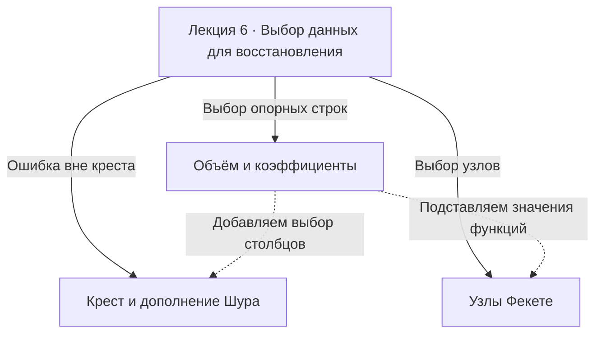
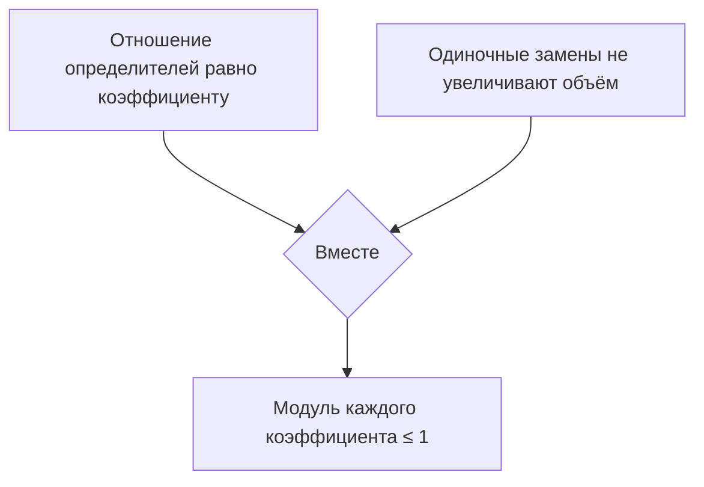
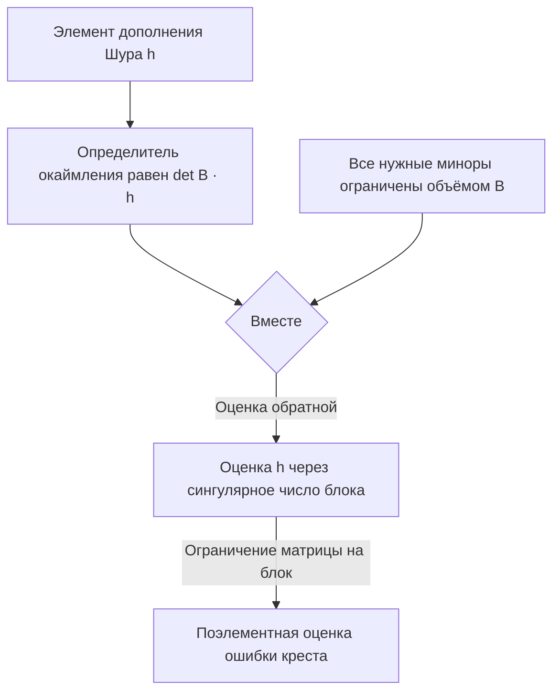
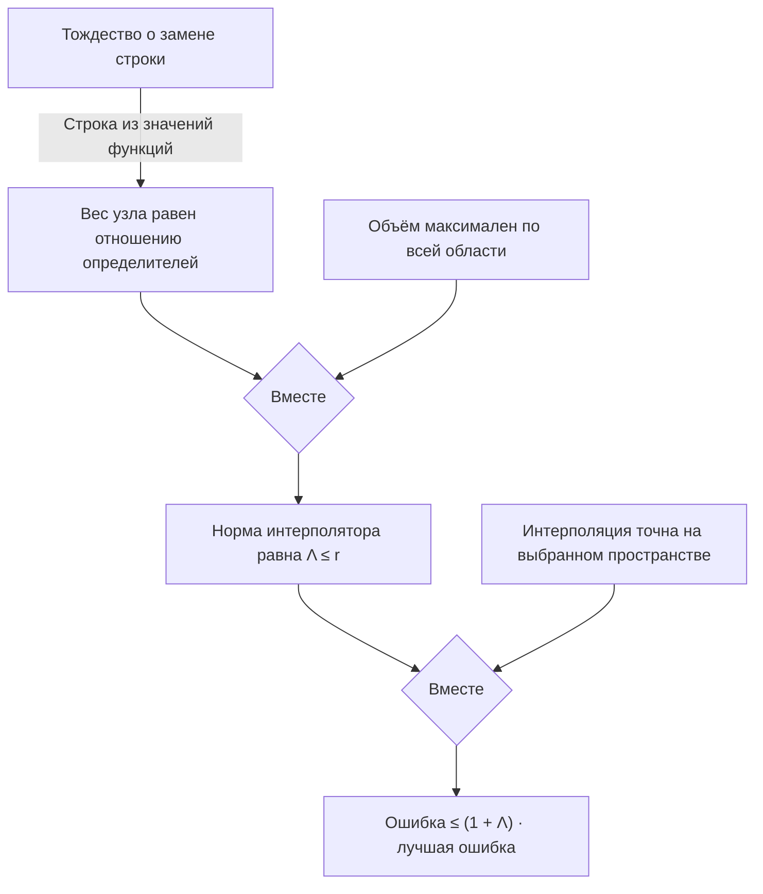

# Граф переходов по принципу максимального объёма

В [[30_mathematics/tyrtyshnikov-video-2026/lectures/tva-06-maxvol-cross#Главный поворот: искать не маленькую матрицу, а достаточную информацию|шестой лекции Тыртышникова]] задача начинается с неполного доступа к матрице. Как выбрать данные, по которым остальное можно восстановить с контролируемой ошибкой? В первом маршруте выбираем строки при заданном пространстве, во втором — строки и столбцы одновременно, в третьем — узлы интерполяции. От того, что разрешено менять, зависит и гарантия.

## Вход из лекции

Если вопрос возник во время лекции, можно сразу открыть нужный переход.

- **Почему замена увеличивает объём?** Начните с [[30_mathematics/computational-algebra-principles/modules/cap-01-volume-coefficients#2. Формула замены строки и доказательство|отношения определителей]]. Оно показывает, какой коэффициент измеряет одиночная замена.
- **Что остаётся за пределами креста?** Откройте [[30_mathematics/computational-algebra-principles/modules/cap-02-cross-schur#1. Формула и точная область определения|формулу остатка]]. Она выделяет блок ошибки, который предстоит оценить.
- **Почему то же правило выбирает узлы?** От [[30_mathematics/tyrtyshnikov-video-2026/lectures/tva-06-maxvol-cross#7. Второй принцип объёма: выбор узлов интерполяции|финала лекции]] перейдите к [[30_mathematics/computational-algebra-principles/modules/cap-03-fekete-interpolation#2. Кардинальные функции: коэффициенты восстановления|кардинальным функциям]]. Здесь коэффициент выражает вклад одного узла в значение интерполянта.

На схемах ниже узел «Вместе» означает, что для вывода нужны все входящие посылки. Ссылки под схемами ведут к формулам и местам, где условия используются.

## Замена строки и коэффициенты

Фиксируем $U\in\mathbb R^{m\times r}$ полного столбцового ранга и невырожденный блок её строк $B=U[I,:]$. Из $U=CB$ известно, как восстановить строки через опоры. Замена $b_j$ строкой $u_i$ позволяет выделить из этого разложения один коэффициент.

1. **Предпосылка.** [[30_mathematics/computational-algebra-principles/modules/cap-01-volume-coefficients#1. Точная постановка|Невырожденность блока]] $B$ даёт единственные координаты $C=UB^{-1}$. Строки $C$, соответствующие уже выбранным опорам, образуют единичный блок.
2. **Вывод.** В [[30_mathematics/computational-algebra-principles/modules/cap-01-volume-coefficients#2. Формула замены строки и доказательство|тождестве замены строки]] $\det B^{(j\leftarrow i)}=c_{ij}\det B$ все вклады с повтором строки равны нулю. Совместим его с проверкой всех одиночных замен на невыбранные строки и получим $\max_{ij}|c_{ij}|\le1$. Глобальная максимальность блока достаточна для этой проверки.
3. **Применение.** При отклике $y=U\theta$ шум измерений $\eta$ переходит в $C\eta$. [[30_mathematics/computational-algebra-principles/modules/cap-01-volume-coefficients#4. Что происходит с шумом и ошибкой модели|Сумма модулей коэффициентов]] даёт $\|C\eta\|_\infty\le r\|\eta\|_\infty$ для доминантного блока. Здесь появляется множитель $r$.
4. **Граница.** [[30_mathematics/computational-algebra-principles/modules/cap-01-volume-coefficients#3. Пример локального, но не глобального максимума|В контрпримере]] блок объёма $1$ удовлетворяет условию на одиночные замены, хотя совместная замена даёт объём $1.62$.

Дальше можно открыть [[30_mathematics/computational-algebra-principles/cap-transition-map#От строк матрицы к узлам Фекете|тот же шаг для значений функций]] или [[30_mathematics/computational-algebra-principles/cap-transition-map#Крест и непрочитанный остаток|задачу с выбором столбцов]].

## Крест и непрочитанный остаток

Берём квадратное невырожденное пересечение $B=A[I,J]$ порядка $r<\min(m,n)$. Теперь цель — ограничить ошибку вне прочитанных строк и столбцов. В доказательстве рассматриваем один элемент остатка $h$ и окаймляем $B$ именно его строкой и столбцом.

1. **Предпосылка и остаток.** Из [[30_mathematics/computational-algebra-principles/modules/cap-02-cross-schur#1. Формула и точная область определения|блочной формулы креста]] следует, что ошибка вне креста равна $H=D-VB^{-1}U$. При точном ранге $r$ этот блок нулевой, потому что выбранные столбцы порождают все столбцы $A$.
2. **Вывод по двум посылкам.** [[30_mathematics/computational-algebra-principles/modules/cap-02-cross-schur#3. Теорема о глобальном максимальном объёме|Формула окаймления]] даёт $\det M=(\det B)h$. Если $h\ne0$ и [[30_mathematics/computational-algebra-principles/modules/cap-02-cross-schur#4. Какие локальные условия действительно нужны|модули всех миноров]] порядка $r$ в $M$ не превосходят $|\det B|$, то каждый [[30_mathematics/computational-algebra-principles/modules/cap-02-cross-schur#Шаг 2. Контролировать всю обратную|элемент обратной]] $M^{-1}$ по модулю не превосходит $1/|h|$. Отсюда $|h|\le(r+1)\sigma_{r+1}(M)$. При $h=0$ оценка выполнена сразу.
3. **Переход к исходной матрице.** [[30_mathematics/computational-algebra-principles/modules/cap-02-cross-schur#Шаг 3. Сравнить сингулярные числа|Ограничение приближения на блок]] сохраняет верхнюю границу ранга $r$ и даёт $\sigma_{r+1}(M)\le\sigma_{r+1}(A)$. Собрав оценки для всех $h$, получаем $\|A-\widehat A\|_{\max}\le(r+1)\sigma_{r+1}(A)$. [[30_mathematics/computational-algebra-principles/modules/cap-02-cross-schur#Шаг 4. Перейти к наилучшей поэлементной ошибке|Сравнение с поэлементным приближением]] даёт второй множитель $r+1$.
4. **Граница переноса.** Контроль миноров включает одновременную замену строки и столбца. В [[30_mathematics/computational-algebra-principles/modules/cap-02-cross-schur#4. Какие локальные условия действительно нужны|контрпримере]] с $\operatorname{diag}(1,L)$ при $L>2$ одиночные замены дают ноль, а совместная замена даёт $L$. Для блока $(1)$ остаток равен $L$, хотя $\sigma_2=1$.

## От строк матрицы к узлам Фекете

Переносим тождество о замене строки в пространство $\mathcal V$ с базисом из $r$ непрерывных функций на компакте $X$. Строка теперь имеет вид $\Phi(x)=(\varphi_1(x),\ldots,\varphi_r(x))$. Опорный блок — матрица значений $V$ на выбранных узлах. Ветвь начинается с того же отношения определителей, а для дальнейшей оценки нужна проверка замен по всей области.

1. **Предпосылка.** [[30_mathematics/computational-algebra-principles/modules/cap-03-fekete-interpolation#Почему подходящие узлы существуют|Независимость базисных функций]] даёт невырожденный набор узлов. Компактность и непрерывность дают достижение положительного максимума объёма.
2. **Точный перенос.** [[30_mathematics/computational-algebra-principles/modules/cap-03-fekete-interpolation#2. Кардинальные функции: коэффициенты восстановления|Координаты строки]] $\Phi(x)V^{-1}$ — веса $\ell_i(x)$. Поэтому $\ell_i(x)=\det V^{(i\leftarrow x)}/\det V$. Максимальность по $X^r$ ограничивает $|\ell_i(x)|$ единицей для всех $x\in X$. Суммирование даёт $\Lambda_X\le r$.
3. **Вывод по двум посылкам.** Из [[30_mathematics/computational-algebra-principles/modules/cap-03-fekete-interpolation#3. Константа Лебега и теорема о квазиоптимальности|ограничения нормы интерполятора и точности на $\mathcal V$]] следует $f-If=(f-p)-I(f-p)$ для любого $p\in\mathcal V$. Значит, $\|f-If\|_\infty\le(1+\Lambda_X)E_{\mathcal V}(f)$. Узлы Фекете дают множитель не больше $r+1$.
4. **Граница переноса.** На конечной сетке $S$ контролируются замены из $S$. [[30_mathematics/computational-algebra-principles/modules/cap-03-fekete-interpolation#5. Конечная сетка и отсутствующая гипотеза|Неравенство нормирующей сетки]] $\|p\|_X\le C_S\|p\|_S$ для всех $p\in\mathcal V$ даёт $\Lambda_X\le C_S\Lambda_S$. [[30_mathematics/computational-algebra-principles/modules/cap-03-fekete-interpolation#Контрпример с меняющимся пространством|Пример на трёх точках]] показывает, что ограниченная $\Lambda_S$ сама по себе допускает неограниченный рост $\Lambda_X$ по семейству пространств.

## Источники и продолжение

Математические источники собраны в [[60_sources/maxvol-principles-primary-sources|карточке принципа максимального объёма]]. Узлы ведут в существующие доказательства и примеры атласа. Способ показать совместные посылки заимствован из [устройства графа LearnHarness](https://github.com/amosblomqvist/learnharness/blob/e3cfff6ee7b91d94cd7ed3eea0dcbf8807773fe8/src/core/contracts/graph.ts#L32-L44).

[[30_mathematics/tyrtyshnikov-video-2026/lectures/tva-06-maxvol-cross|Вернуться к лекции Тыртышникова]] · [[30_mathematics/computational-algebra-principles/cap-map|Вернуться к карте курса]] · [[70_labs/computational-algebra-principles/cap-visual-lab|Открыть лабораторную работу]]
